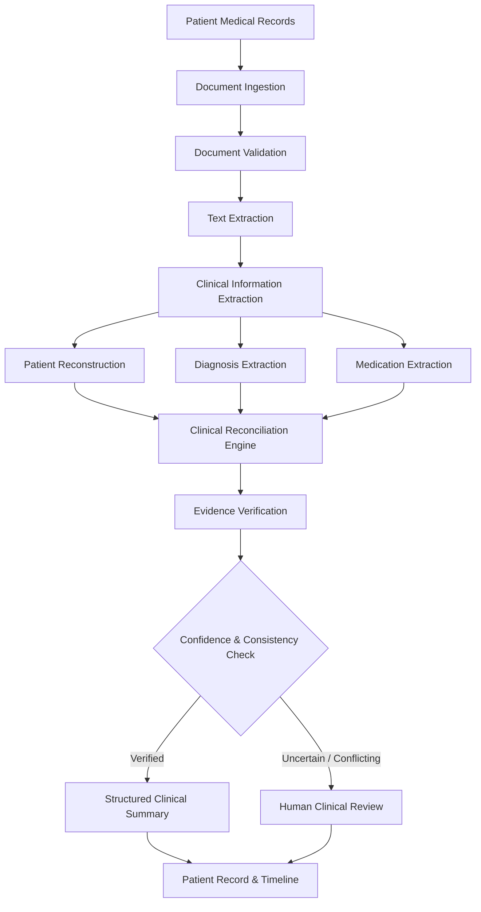
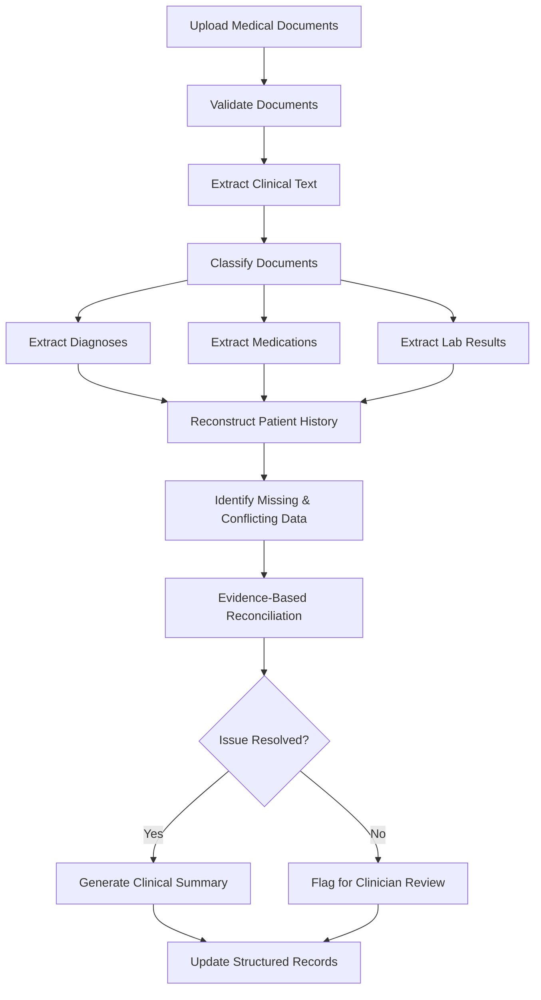

<p align="center">
  
</p>
# 🏥 MEDUSA-X
### The Clinical Record That Cannot Be Trusted

**Agentic Clinical Intelligence for Patient Reconstruction, Medical Reconciliation & Safe Decision Support**


---

## 🧠 Overview

Healthcare data is rarely complete, consistent, or organized.

Patient information is distributed across admission notes, laboratory reports, prescriptions, progress notes, and discharge summaries. These fragmented records can contain conflicting diagnoses, outdated medications, missing information, delayed test results, and undocumented treatment changes.

**MEDUSA-X** is an agentic clinical intelligence platform designed to reconstruct patient information from fragmented medical records, identify inconsistencies, reconcile clinical information, and generate structured clinical summaries.

Unlike conventional AI systems that may produce unsupported conclusions, MEDUSA-X emphasizes evidence verification, uncertainty awareness, and controlled escalation.

Its central principle:

> An intelligent clinical system must know what it can conclude, what it cannot conclude, and when it must stop.

## 🎯 Problem Statement

Traditional healthcare information systems primarily store and display medical records. However, they often lack the intelligence to:

- Identify contradictions across multiple medical documents.
- Reconstruct chronological patient histories.
- Detect missing or outdated clinical information.
- Reconcile conflicting diagnoses and medications.
- Trace conclusions back to their supporting evidence.
- Recognize uncertainty and escalate unresolved issues.

MEDUSA-X addresses these challenges through an integrated clinical intelligence workflow.

## 💡 Proposed Solution

MEDUSA-X aims to transform fragmented medical records into structured, evidence-backed clinical information.

The platform focuses on five core capabilities:

1. **Patient Reconstruction** – Organizing fragmented medical information into a coherent patient history.
2. **Clinical Intelligence** – Extracting relevant information from unstructured medical documents.
3. **Medical Reconciliation** – Identifying inconsistencies between diagnoses, medications, and clinical records.
4. **Evidence Verification** – Connecting extracted information and conclusions to their original sources.
5. **Uncertainty Management** – Flagging unresolved conflicts instead of generating unsupported clinical assumptions.

## ⭐ Key Features

| Feature | Description |
|---|---|
| Patient Management | Centralized patient information and records |
| Medical Document Processing | Uploading and processing clinical documents |
| Clinical Information Extraction | Extracting structured information from medical records |
| Diagnosis Reconciliation | Identifying conflicting or inconsistent diagnoses |
| Medication Reconciliation | Detecting medication discrepancies |
| Clinical Summaries | Generating structured patient summaries |
| Patient Timeline | Organizing medical events chronologically |
| Evidence Tracking | Maintaining links to supporting documents |
| Clinical Review | Presenting unresolved issues for human verification |
| Interactive 3D Interface | Immersive healthcare workspace |

## 🏗️ System Architecture



## 🔄 Clinical Processing Workflow



## 🛡️ Safety-First Intelligence

Clinical reliability is a core design principle of MEDUSA-X.

The platform is designed around the following principles:

- **Evidence-Based Extraction:** Clinical information should be traceable to source documents.
- **No Unsupported Assumptions:** Missing information must not be treated as confirmed clinical facts.
- **Conflict Detection:** Contradictory information should be identified rather than silently overwritten.
- **Uncertainty Awareness:** Unresolved information should be flagged for review.
- **Human-in-the-Loop:** Clinical decisions remain under qualified human supervision.
- **Traceability:** Extracted information should retain its document-level evidence.

MEDUSA-X is intended as a clinical information support platform, not a replacement for qualified healthcare professionals.

## 🧰 Technology Stack

### Frontend
- React.js
- JavaScript
- CSS
- Three.js
- Lucide React

### Backend
- Python
- Django
- Django REST Framework

### Database
- SQLite

### Document Processing
- Python
- PDF Text Extraction
- Clinical Information Extraction
- Rule-Based Reconciliation

### Intelligent Processing
- Clinical NLP
- Evidence-Based Information Extraction
- Clinical Conflict Detection
- Uncertainty-Aware Review

*The technology list describes the project's implementation direction. Individual capabilities may be at different stages of development.*

## 📂 Project Structure

```text
MEDUSA-X/
│
├── .gitignore
├── README.md
│
├── MEDUSA-X/
│   ├── .gitignore
│   │
│   └── backend/
│       ├── db.sqlite3
│       ├── manage.py
│       │
│       ├── accounts/
│       │   ├── admin.py
│       │   ├── apps.py
│       │   ├── models.py
│       │   ├── tests.py
│       │   ├── urls.py
│       │   ├── views.py
│       │   ├── __init__.py
│       │   └── migrations/
│       │       └── __init__.py
│       │
│       ├── alerts/
│       │   ├── admin.py
│       │   ├── apps.py
│       │   ├── models.py
│       │   ├── tests.py
│       │   ├── urls.py
│       │   ├── views.py
│       │   ├── __init__.py
│       │   └── migrations/
│       │       ├── 0001_initial.py
│       │       └── __init__.py
│       │
│       ├── audit/
│       │   ├── admin.py
│       │   ├── apps.py
│       │   ├── models.py
│       │   ├── services.py
│       │   ├── tests.py
│       │   ├── urls.py
│       │   ├── views.py
│       │   ├── __init__.py
│       │   └── migrations/
│       │       ├── 0001_initial.py
│       │       └── __init__.py
│       │
│       ├── clinical_ai/
│       │   ├── admin.py
│       │   ├── apps.py
│       │   ├── models.py
│       │   ├── services.py
│       │   ├── tests.py
│       │   ├── urls.py
│       │   ├── views.py
│       │   ├── __init__.py
│       │   └── migrations/
│       │       ├── 0001_initial.py
│       │       └── __init__.py
│       │
│       ├── config/
│       │   ├── asgi.py
│       │   ├── settings.py
│       │   ├── urls.py
│       │   ├── wsgi.py
│       │   └── __init__.py
│       │
│       ├── patients/
│       │   ├── admin.py
│       │   ├── apps.py
│       │   ├── models.py
│       │   ├── serializers.py
│       │   ├── tests.py
│       │   ├── urls.py
│       │   ├── views.py
│       │   ├── __init__.py
│       │   └── migrations/
│       │       ├── 0001_initial.py
│       │       └── __init__.py
│       │
│       ├── reconciliation/
│       │   ├── admin.py
│       │   ├── apps.py
│       │   ├── models.py
│       │   ├── services.py
│       │   ├── tests.py
│       │   ├── urls.py
│       │   ├── views.py
│       │   ├── __init__.py
│       │   └── migrations/
│       │       ├── 0001_initial.py
│       │       └── __init__.py
│       │
│       ├── records/
│       │   ├── admin.py
│       │   ├── apps.py
│       │   ├── models.py
│       │   ├── serializers.py
│       │   ├── tests.py
│       │   ├── urls.py
│       │   ├── views.py
│       │   ├── __init__.py
│       │   └── migrations/
│       │       ├── 0001_initial.py
│       │       └── __init__.py
│       │
│       └── media/
│           └── clinical_documents/
│               ├── Emergency_Patient_Triage_and_Intake_Record_3.pdf
│               ├── Emergency_Patient_Triage_and_Intake_Record_3_Jc6XMhG.pdf
│               └── Emergency_Patient_Triage_and_Intake_Record_3_LR3O5cz.pdf
│
├── MEDUSA-X/backend/
│   ├── .env
│   ├── .env.txt
│   ├── db.sqlite3
│   ├── final_inspection.txt
│   ├── manage.py
│   ├── requirements.txt
│   ├── services_backup.txt
│   │
│   ├── accounts/
│   │   ├── admin.py
│   │   ├── apps.py
│   │   ├── models.py
│   │   ├── tests.py
│   │   ├── urls.py
│   │   ├── views.py
│   │   ├── __init__.py
│   │   └── migrations/
│   │       └── __init__.py
│   │
│   ├── alerts/
│   │   ├── admin.py
│   │   ├── apps.py
│   │   ├── models.py
│   │   ├── tests.py
│   │   ├── urls.py
│   │   ├── views.py
│   │   ├── __init__.py
│   │   └── migrations/
│   │       ├── 0001_initial.py
│   │       └── __init__.py
│   │
│   ├── audit/
│   │   ├── admin.py
│   │   ├── apps.py
│   │   ├── models.py
│   │   ├── services.py
│   │   ├── tests.py
│   │   ├── urls.py
│   │   ├── views.py
│   │   ├── __init__.py
│   │   └── migrations/
│   │       ├── 0001_initial.py
│   │       └── __init__.py
│   │
│   ├── clinical_ai/
│   │   ├── admin.py
│   │   ├── apps.py
│   │   ├── models.py
│   │   ├── services.py
│   │   ├── tests.py
│   │   ├── urls.py
│   │   ├── views.py
│   │   ├── __init__.py
│   │   └── migrations/
│   │       ├── 0001_initial.py
│   │       └── __init__.py
│   │
│   ├── config/
│   │   ├── asgi.py
│   │   ├── settings.py
│   │   ├── urls.py
│   │   ├── wsgi.py
│   │   └── __init__.py
│   │
│   ├── patients/
│   │   ├── admin.py
│   │   ├── apps.py
│   │   ├── models.py
│   │   ├── serializers.py
│   │   ├── tests.py
│   │   ├── urls.py
│   │   ├── views.py
│   │   ├── __init__.py
│   │   └── migrations/
│   │       ├── 0001_initial.py
│   │       └── __init__.py
│   │
│   ├── reconciliation/
│   │   ├── admin.py
│   │   ├── apps.py
│   │   ├── models.py
│   │   ├── services.py
│   │   ├── tests.py
│   │   ├── urls.py
│   │   ├── views.py
│   │   ├── __init__.py
│   │   └── migrations/
│   │       ├── 0001_initial.py
│   │       └── __init__.py
│   │
│   ├── records/
│   │   ├── admin.py
│   │   ├── apps.py
│   │   ├── models.py
│   │   ├── serializers.py
│   │   ├── tests.py
│   │   ├── urls.py
│   │   ├── views.py
│   │   ├── __init__.py
│   │   └── migrations/
│   │       ├── 0001_initial.py
│   │       └── __init__.py
│   │
│   └── media/
│       └── clinical_documents/
│           ├── 1_Blood_Test_Lab_Report_1.pdf
│           ├── 1_Blood_Test_Lab_Report_1_718k8SO.pdf
│           ├── Emergency_Patient_Triage_and_Intake_Record_3.pdf
│           ├── Emergency_Patient_Triage_and_Intake_Record_3_Jc6XMhG.pdf
│           ├── Emergency_Patient_Triage_and_Intake_Record_3_LR3O5cz.pdf
│           ├── Sahana_BP_Checkup_Synthetic_Record.pdf
│           └── sample_laboratory_report_hackathon.pdf
│
├── MEDUSA-X/web/
│   ├── .gitignore
│   ├── eslint.config.js
│   ├── index.html
│   ├── package-lock.json
│   ├── package.json
│   ├── README.md
│   ├── README.txt
│   ├── vite.config.js
│   │
│   ├── public/
│   │   ├── favicon.svg
│   │   ├── icons.svg
│   │   └── models/
│   │       ├── doctor.glb
│   │       └── patient.glb
│   │
│   └── src/
│       ├── api-backup.js
│       ├── api.js
│       ├── App.css
│       ├── App.jsx
│       ├── index.css
│       ├── Landing.css
│       ├── Landing.jsx
│       ├── main.jsx
│       ├── MedusaHospital3D.css
│       ├── MedusaHospital3D.jsx
│       └── assets/
│           ├── hero.png
│           ├── react.svg
│           └── vite.svg
│
└── web/
    ├── .gitignore
    ├── eslint.config.js
    ├── index.html
    ├── package-lock.json
    ├── package.json
    ├── README.md
    ├── README.txt
    ├── vite.config.js
    │
    ├── public/
    │   ├── favicon.svg
    │   ├── icons.svg
    │   └── models/
    │       ├── doctor.glb
    │       └── patient.glb
    │
    └── src/
        ├── api-backup.js
        ├── api.js
        ├── App.css
        ├── App.jsx
        ├── index.css
        ├── Landing.css
        ├── Landing.jsx
        ├── Layout.css
        ├── Login.css
        ├── Login.jsx
        ├── main.jsx
        ├── MedusaHospital3D.css
        ├── MedusaHospital3D.jsx
        └── assets/
            ├── hero.png
            ├── react.svg
            └── vite.svg
```

## 🚀 Project Objectives

- Transform fragmented medical records into structured patient information.
- Improve visibility into conflicting clinical data.
- Support chronological patient-history reconstruction.
- Reduce the risk of overlooking important information.
- Enable evidence-backed clinical summaries.
- Establish a safety-first foundation for agentic clinical intelligence.

## 🔮 Future Scope

- Advanced Agentic AI orchestration.
- Clinical Large Language Model integration.
- Medical Named Entity Recognition (NER).
- Advanced clinical relationship extraction.
- Multi-agent clinical verification.
- FHIR-based healthcare interoperability.
- Enhanced medical image and scanned-document processing.
- Confidence calibration and uncertainty estimation.
- Secure cloud deployment.

## ⚠️ Disclaimer

MEDUSA-X is a development and research project intended to support clinical information organization and review.

It is not a certified medical device and must not be used as a substitute for professional medical diagnosis, treatment, or clinical judgment.

## 👩‍💻 Project Vision

**MEDUSA-X — Because healthcare intelligence should not just generate answers. It should justify them.**

*Reconstruct. Reconcile. Verify. Escalate.*

##PPT
https://1drv.ms/p/c/385394C7C3031EC2/IQCykLSUC5FaRalqWAghA0cTARrQgOct7RZN5jEvDLzaiVA?e=q1W5Ss

##DEMONSTRATION
https://youtu.be/o9U7BK2GBL4?si=3tWSkbWBNJlXwrPu
